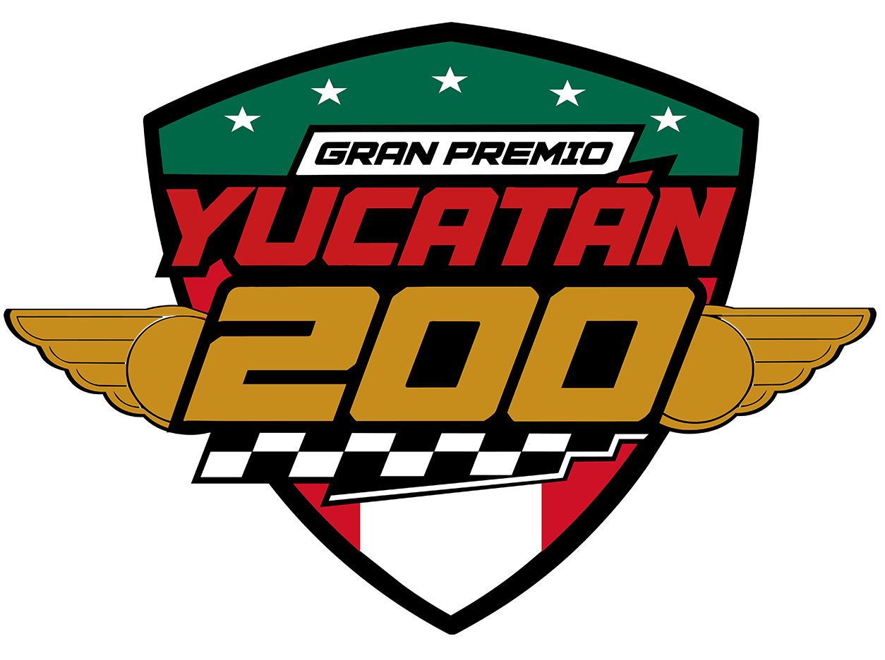

# nascar-mexico-predictions2026
Machine Learning pipeline using XGBoost to predict the NASCAR Mexico Series race results. It integrates live championship data from Race.mx and real-time weather forecasts from OpenWeatherMap to model thermal stress and driver momentum.

<p align="center">
  
</p>

# 🏎️🏁 NASCAR México Series Predictor

Un pipeline de Machine Learning en Python desarrollado para predecir el orden de llegada de la parrilla completa (20 autos) en el **Gran Premio Yucatán 200** de NASCAR México Series, disputado en el Autódromo Emerson Fittipaldi (Mérida, Yucatán).

## 📸 Acción en Pista (17 de Octubre, 2026)
*Documentación visual directa desde el Autódromo Emerson Fittipaldi durante el fin de semana de carrera.*

<p align="center">
  
</p>

## 🚀 Arquitectura del Proyecto

Este modelo no utiliza datos simulados; se alimenta de información real y verificable del campeonato:

* **Ingesta en Vivo (Race.mx):** Conexión a la API oficial de datos abiertos para extraer los *Standings* del Chase en tiempo real y la parrilla titular.
* **Clima Dinámico (OpenWeatherMap):** Integración de telemetría meteorológica (temperatura y probabilidad de lluvia) de Mérida para calcular un índice personalizado de `HeatTrafficStress`.
* **Feature Engineering:** 
  * `ChaseMomentum`: Rastrea la trayectoria de rendimiento del piloto comparando su semilla inicial de Playoffs con su ranking actual.
  * `TargetDominanceScore`: Variable objetivo compuesta que pondera el desempeño en campeonato regular vs. Playoffs.
* **Modelo Predictivo:** Implementación de `XGBRegressor` con **Restricciones Monotónicas** (para forzar coherencia deportiva en el árbol de decisión) y **Validación Cruzada Leave-One-Out (LOOCV)** con predicciones *Out-Of-Fold* para eliminar por completo el *overfitting* en la parrilla.

## 🛠️ Tecnologías Utilizadas

* **Lenguaje:** Python 3.12
* **Machine Learning:** XGBoost, Scikit-Learn
* **Data Wrangling:** Pandas, NumPy
* **APIs:** Requests, JSON

## ⚙️ Instalación y Uso

1. Clona el repositorio e instala las dependencias:
```bash
git clone https://github.com/TU_USUARIO/nascar-mexico-predictions2026.git
cd nascar-mexico-predictions2026
python -m venv .venv
source .venv/bin/activate  # En Windows: .venv\Scripts\activate
pip install -r requirements.txt
```

2. Configura tus llaves de API creando un archivo `.env` en la raíz del proyecto:
```env
OPENWEATHERMAP_API_KEY=tu_api_key_aqui
```

3. Ejecuta el pipeline completo desde el Jupyter Notebook:
```bash
jupyter notebook notebook/main.ipynb
```

## 📝 Licencias

* **Código:** Este proyecto se distribuye bajo la [Licencia MIT](LICENSE). Eres libre de utilizar y modificar la arquitectura del modelo predictivo.
* **Datos:** La información de posiciones, pilotos y sedes es extraída de la API abierta de [Race.mx](https://race.mx) y se utiliza bajo la licencia [CC BY 4.0](https://creativecommons.org/licenses/by/4.0/).